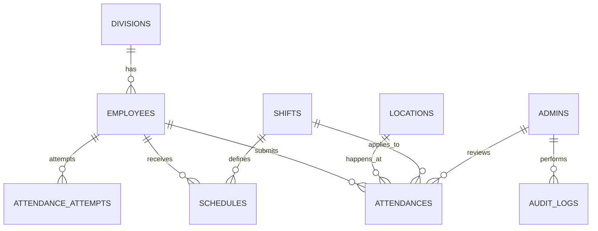

# Database Schema Specification

## 1. Standar

- Target: MySQL 8.0, InnoDB, strict mode.
- Charset/collation: `utf8mb4` / `utf8mb4_unicode_ci`.
- Zona waktu bisnis: `Asia/Jakarta`; sesi MySQL: `+07:00`.
- `work_date`: tanggal mulai shift, termasuk shift lintas hari.
- Definisi otoritatif tetap migration Laravel pada `backend/database/migrations`.

## 2. Relasi



## 3. Tabel

### `admins`

| Kolom utama | Ketentuan |
|---|---|
| `email` | unik |
| `password` | hash |
| `role` | `superadmin`, `supervisor`, atau `operator` |
| `is_active` | wajib aktif untuk melewati RBAC |

### `divisions`

Master unit kerja. `code` unik; `name`, `description`, dan `is_active` menyertai record.

### `employees`

| Kolom utama | Ketentuan |
|---|---|
| `division_id` | FK `divisions`, `ON DELETE RESTRICT` |
| `employee_code` | unik |
| `pin_hash` | hash PIN numerik tepat 6 digit; tidak pernah dikirim dalam respons |
| `failed_pin_attempts` | default `0` |
| `locked_until` | nullable; lock 15 menit setelah lima kegagalan |
| `is_active` | default `true` |

### `locations`

Master pusat geofence: `latitude`, `longitude`, `radius_meters`, alamat, dan status aktif. Presensi memilih lokasi aktif yang dikonfigurasi backend.

### `shifts`

| Kolom | Tipe/default | Makna |
|---|---|---|
| `start_time` | `TIME` | awal shift |
| `end_time` | `TIME` | akhir shift |
| `check_in_window_start_minutes` | unsigned, `60` | menit sebelum awal shift |
| `check_in_window_end_minutes` | unsigned, `240` | menit setelah awal shift |
| `late_tolerance_minutes` | unsigned, `15` | toleransi keterlambatan |
| `check_out_window_start_minutes` | unsigned, `30` | menit sebelum akhir shift |
| `check_out_window_end_minutes` | unsigned, `240` | menit setelah akhir shift |
| `is_cross_day` | boolean | akhir shift berada pada hari berikutnya |
| `is_active` | boolean | hanya shift aktif dapat di-resolve |

### `schedules`

- FK wajib ke `employees` dan `shifts`.
- `schedule_date` adalah tanggal mulai shift.
- Unique key `employee_id + schedule_date`.
- Tidak ada fallback ke shift terdekat.

### `attendances`

Attendance hanya dibuat untuk jadwal, shift, dan lokasi yang valid.

| Kelompok | Kolom |
|---|---|
| Identitas | `employee_id`, `location_id`, `shift_id`, `work_date` |
| Check-in | timestamp, koordinat, akurasi, jarak server, private photo path |
| Check-out | timestamp, koordinat, akurasi, jarak server, private photo path |
| Status | `on_time`, `late`, `early_leave`, `absent`, `needs_review`, `corrected` |
| Review | `is_flagged`, alasan, reviewer, waktu, catatan |
| Teknis | IP dan User-Agent |

Constraint final deduplikasi:

```sql
UNIQUE KEY uk_attendance_employee_workdate_shift
(employee_id, work_date, shift_id)
```

### `attendance_attempts`

Penolakan yang tidak boleh menjadi sesi attendance disimpan di sini.

| Kolom | Ketentuan |
|---|---|
| `employee_id` | FK valid ke pegawai |
| `reason_code` | `SCHEDULE_MISSING`, `SCHEDULE_AMBIGUOUS`, atau `OUTSIDE_ATTENDANCE_WINDOW` |
| `message` | pesan aman untuk audit |
| GPS | nullable pada pre-check; terisi pada submit |
| `client_ip`, `user_agent` | metadata request |
| `attempted_at` | waktu server WIB |

Attempt tidak memiliki `shift_id`, `location_id`, atau foto. Dengan demikian sistem tidak mengarang relasi dan tidak menyimpan selfie untuk penolakan awal.

### `audit_logs`

Mencatat admin, entitas, aksi, snapshot aman, alasan, IP, User-Agent, dan waktu. PIN, hash PIN, token, serta secret tidak boleh masuk snapshot. Mutasi bisnis dan audit dibuat dalam transaksi yang sama.

### `personal_access_tokens`

Tabel standar Laravel Sanctum untuk token admin. Token plaintext hanya dikembalikan saat login dan tidak disimpan di audit log.

## 4. Transaksi dan File

1. Lock row pegawai.
2. Resolve dan lock schedule/attendance terkait.
3. Validasi window serta geofence.
4. Simpan selfie ke disk `private` hanya setelah validasi awal lulus.
5. Insert/update attendance dalam transaksi.
6. Jika transaksi gagal setelah file dibuat, file baru dihapus.
7. File milik attendance valid tidak dihapus pada retry.
8. Kegagalan cleanup dicatat `critical` dan diteruskan sebagai error.

> [!IMPORTANT]
> Perilaku lock harus diverifikasi pada MySQL/InnoDB. SQLite tidak membuktikan concurrency target.

## 5. Retensi

Retensi selfie enam bulan tercatat sebagai aturan produk. Job penghapusan belum diimplementasikan pada fase CI-only ini; jangan mengklaim cleanup retensi otomatis sudah aktif.
